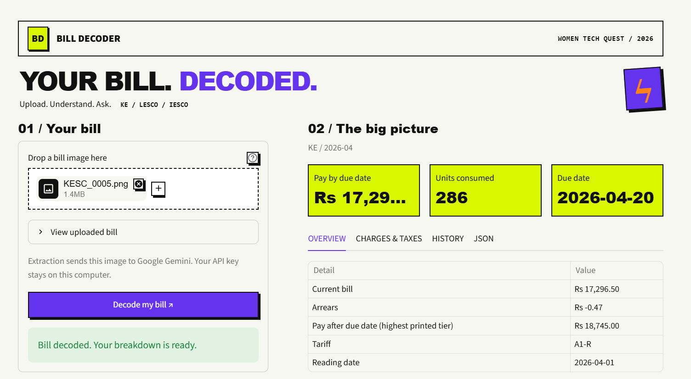
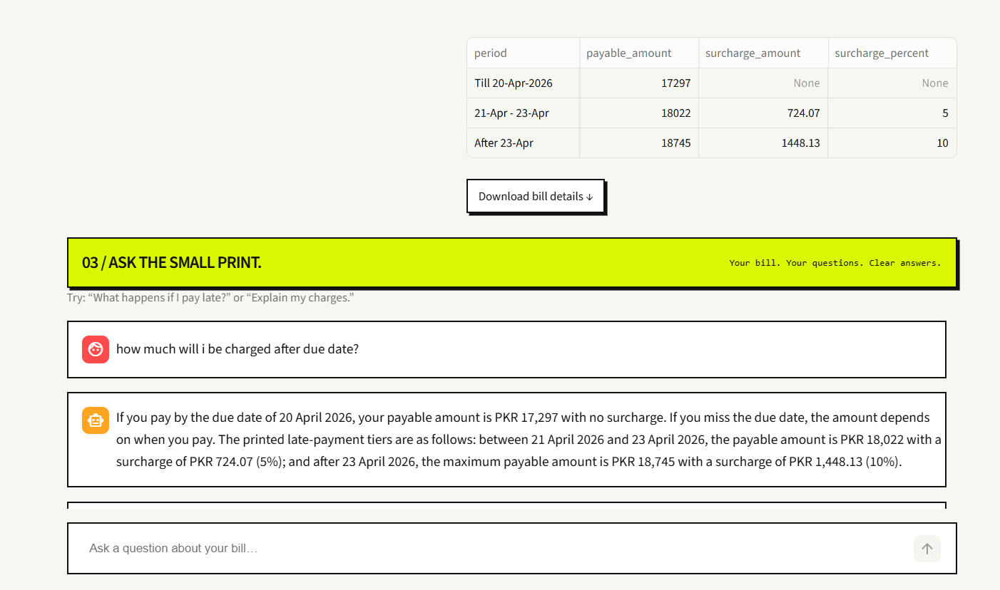

# Bill Decoder ⚡

**Upload. Understand. Ask.**

An AI-powered Streamlit app that turns Pakistani electricity bills into structured
details and evidence-grounded answers. Built for **Women Tech Quest 2026**, with a
bold interface inspired by neo-brutalism.

Supports KE, LESCO and IESCO bill images. Review payment dates, usage, charges,
taxes, printed history and late-payment tiers. Download extracted JSON or ask
questions in plain language. The shared pipeline validates model output with
Pydantic and performs supported arithmetic with Python Decimal.

## App overview

### Understand your bill at a glance

Upload a PNG or JPG, decode it, and review the payable amount, electricity usage,
and due date. Switch between **Overview**, **Charges & Taxes**, **History**, and
**JSON** to explore the printed details. The original bill preview stays available
in a collapsible panel.



### Ask questions about the small print

Ask questions in plain language, such as “How much will I be charged after the due
date?” Answers use the extracted bill evidence and supported calculations. When a
bill prints multiple late-payment tiers, the app preserves their dates, payable
amounts, and surcharges instead of showing only one penalty. Download the bill
details as JSON for further use.



*Screenshots show one example bill; amounts and dates vary with the uploaded bill.*

## Features

- **KE, LESCO, and IESCO support:** extract details from electricity bill images.
- **Validated extraction:** enforce structured fields with Pydantic.
- **Payment breakdown:** inspect charges, taxes, arrears, and late-payment tiers.
- **Printed history:** review monthly usage and payment data where readable.
- **Grounded Q&A:** combine bill evidence with restricted Python Decimal arithmetic.
- **JSON export:** download extracted details without copying tables manually.
- **Compact interface:** collapsible preview and bounded conversation history.
- **Local caching:** reuse completed extraction and answer results.

## Tech stack

| Component | Technology |
| --- | --- |
| Language | Python 3.11+ (3.12 recommended) |
| Browser interface | Streamlit |
| AI inference | Google Gemini API |
| Structured validation | Pydantic |
| Image handling | Pillow |
| Calculations | Python Decimal |
| Local configuration | python-dotenv |

## Run on Windows

Python 3.12 recommended (minimum 3.11). In the project folder:

```powershell
py -3.12 -m venv .venv
.venv\Scripts\python.exe -m pip install -r source/requirements.txt
Copy-Item source/.env.example .env
```

Edit `.env` and set your own Google Gemini API key. Never commit it.

```powershell
.venv\Scripts\python.exe -m streamlit run streamlit_app.py
```

Open http://127.0.0.1:8501. Upload a clear PNG or JPG (up to 20 MB), click
**Decode my bill**, review the breakdown, and ask a question below.

## Privacy and limitations

Decoding sends the uploaded image to the configured Google Gemini API. The app
removes its temporary upload after processing. Extracted evidence and answers
are cached locally in `cache/`; the upload preview and conversation live in the
browser session. Model responses may contain mistakes; check important amounts
against the original bill. API quota, latency and availability depend on your account.
The server binds to localhost by default; this project is intended for personal use.

Credentials, caches, generated outputs, private bill datasets, recordings and
submission ZIPs are excluded by `.gitignore`. Supply your own bill images.

## Project layout

- `streamlit_app.py`: browser entry point
- `source/web_app.py` and `source/web_style.css`: interface
- `source/`: extraction, validation, question answering, CLI and tests
- `.streamlit/config.toml`: theme and local server settings
- `docs/images/`: screenshots displayed in this README

## Check the project

```powershell
.venv\Scripts\python.exe -m unittest discover -s source -p test_pipeline.py -v
.venv\Scripts\python.exe -m unittest discover -s source -p test_web_app.py -v
```
